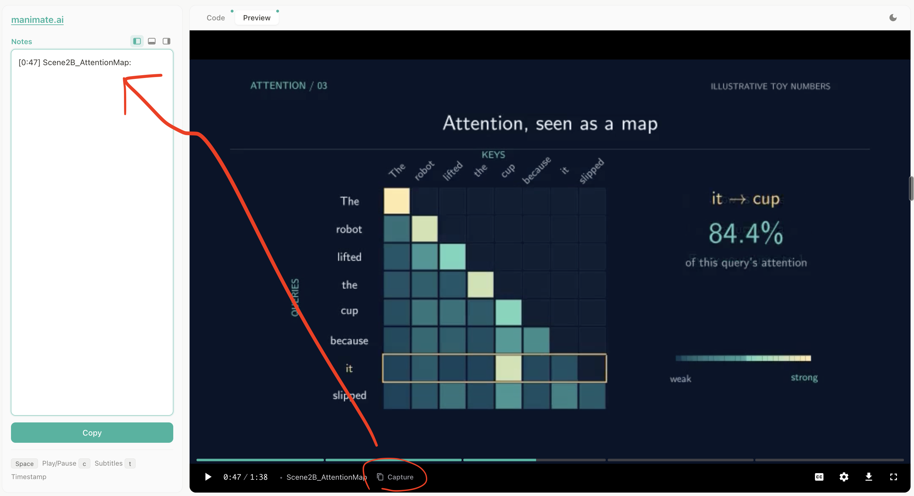

# 3b1b-skill

Two agent skills for explaining things clearly, after [Karpathy's tip](https://x.com/karpathy) to ask models for "a 3b1b style video explainer" and for ASD-STE100 writing.

| Skill | What it does |
|---|---|
| [`3b1b`](skills/3b1b/SKILL.md) | Makes a narrated explainer video in the visual style of 3Blue1Brown with Manim: question first, concrete example, color-coded math, smooth transforms, voiceover with synced subtitles. |
| [`ste100`](skills/ste100/SKILL.md) | Writes or rewrites text in ASD-STE100 Simplified Technical English (strict or relaxed). The `3b1b` skill uses relaxed mode for its narration. |

Forked from [Yusuke710/manim-skill](https://github.com/Yusuke710/manim-skill) (MIT).

## What changed from upstream

- **A real style guide.** `references/style.md` turns the 3b1b look into checkable rules: story arc, fixed color key, typography, motion vocabulary, and a reject list.
- **A Manim cookbook.** `references/cookbook.md` has patterns for morphing color-coded equations, `ValueTracker` sliders, camera zooms, linear maps, 3D, and the traps that cost re-renders.
- **Three voices.** `tts-generate.py --engine auto|gemini|elevenlabs|kokoro`. Cloud engines run four clips in parallel and retry on 429/5xx.
- **One-command setup.** `tools/setup.sh` builds a manim venv and installs TinyTeX (no sudo) with the LaTeX packages manim needs, then prints a doctor report.
- **Self-review.** `tools/contact-sheet.sh` tiles 12 frames so the agent checks its own output before showing it.
- **Background-safe viewer.** `video_viewer.py --no-open` serves the review page without opening a browser.

## Install

```bash
git clone https://github.com/seanx10m/3b1b-skill.git
ln -s "$PWD/3b1b-skill/skills/3b1b" ~/.claude/skills/3b1b
ln -s "$PWD/3b1b-skill/skills/ste100" ~/.claude/skills/ste100
3b1b-skill/skills/3b1b/tools/setup.sh        # add --kokoro for the offline voice
```

Or as a Claude Code plugin: `/plugin marketplace add seanx10m/3b1b-skill`.

For narration, set `GEMINI_API_KEY` (or write `~/.gemini_api_key`), or `ELEVENLABS_API_KEY`, or run setup with `--kokoro`.

## Use

```
/3b1b explain why the harmonic series diverges
/ste100 rewrite this runbook in strict mode
```

Videos land in `~/.manim-skill/<topic>/video.mp4`.


